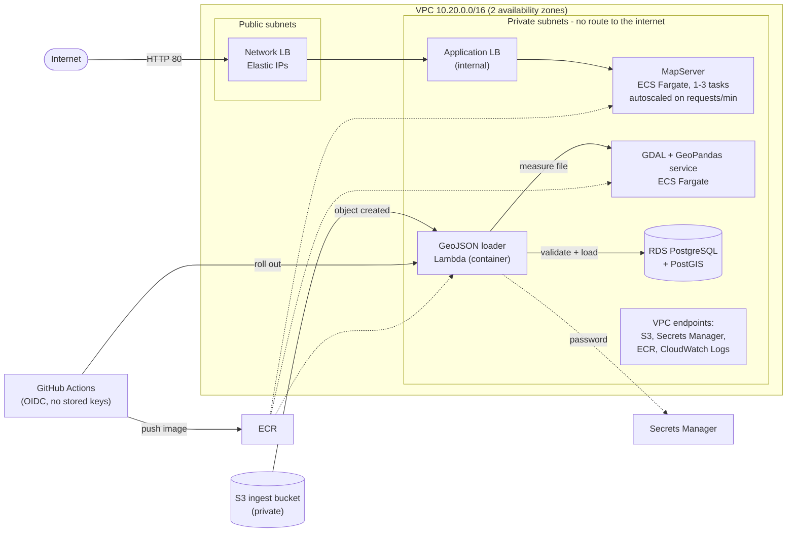

# ASTERRA DevOps assignment

A small geospatial platform on AWS, built entirely from code and deployed by one script.

- **SaaS part** - a GeoJSON file dropped into a private S3 bucket is validated and loaded into a private PostGIS database by a container Lambda. A GitHub Actions pipeline tests, versions and deploys the loader on every merge to `main`.
- **PaaS part** - a public MapServer (WMS) on Elastic IPs with request-based autoscaling, and a private GDAL + GeoPandas microservice.
- **Bonus** - the same stack on a local Kubernetes cluster.

## Architecture



| Requirement | How it is met |
|---|---|
| Private PostGIS RDS, private S3 bucket, IAM (II.1) | `terraform/rds.tf`, `s3_ingest.tf`, `lambda.tf`. The loader enables PostGIS from inside the VPC during `terraform apply`. |
| Containerized loader triggered by S3, logs to CloudWatch (II.2) | `app/` - container Lambda. One JSON log line per step. |
| CI/CD: build, test, code checks, version bump, deploy on merge to `main` (II.3) | `.github/workflows/ci.yml`, `release.yml`. |
| Public service on a static IP (III.A.1) | MapServer behind a network load balancer with Elastic IPs (`terraform/lb.tf`). |
| Private GDAL microservice (III.A.2) | `services/gdal`, ECS Fargate in private subnets, private DNS name only. |
| Sufficient resources (III.B) | CPU and memory of every workload are variables in `terraform/variables.tf`. |
| Networking (III.C) | Public subnets hold only the load balancer. Everything else is private and reachable inside the VPC. |
| GeoPandas in a container, images in ECR (III.D) | `services/gdal/Dockerfile` adds GeoPandas to the official GDAL image. Three ECR repositories. |
| One script, any region (IV.1) | `scripts/deploy.sh <region>` and `scripts/destroy.sh <region>`. |
| No hard-coded configuration (IV.1.c) | Everything is a Terraform variable; versions live in `VERSION` files. |
| IaC stored in a private S3 bucket (IV.1.d) | `deploy.sh` keeps the Terraform state and a copy of the repository in `asterra-iac-<account>-<region>`. |
| Security (IV.2) | See [Security](#security). |
| Half-pager in a public S3 bucket (IV.3) | `docs/index.html`, published by `terraform/docs.tf`. |
| Kubernetes bonus (V.A) | `k8s/` - kind cluster with PostGIS, all three containers and network policies. |
| Autoscaling bonus (V.B) | ECS target tracking on ALB requests per task per minute (`terraform/ecs.tf`). |

**About RDP (III.C.3).** The assignment offers a choice between a non-interactive GDAL microservice and an interactive GIS workspace. I chose the microservice, so there is no desktop to connect to and no RDP port is opened anywhere.

## Deploy

Prerequisites: AWS CLI (signed in), Terraform >= 1.10, Docker, Python 3, and the GitHub CLI signed in (used to point the release pipeline at the new environment).

```bash
./scripts/deploy.sh eu-north-1     # create or update everything in a region
./tests/smoke_test.sh eu-north-1   # end-to-end test of the deployed environment
./scripts/destroy.sh eu-north-1    # remove everything from a region
```

Moving to another region is the same two commands with different arguments:

```bash
./scripts/deploy.sh eu-west-1 && ./tests/smoke_test.sh eu-west-1
./scripts/destroy.sh eu-north-1
```

`deploy.sh` does, in order: create the private IaC bucket, register GitHub as an OIDC provider (once per account), create the ECR repositories, build and push the three images, apply the rest of the infrastructure, upload the IaC copy, and set the GitHub repository variables the release pipeline reads.

To change a setting, copy `terraform/terraform.tfvars.example` to `terraform/terraform.tfvars`.

## Use

```bash
# Load a file: copy any *.geojson into the ingest bucket
aws s3 cp app/samples/valid.geojson s3://$(terraform -chdir=terraform output -raw ingest_bucket)/

# Follow what the loader did
aws logs tail $(terraform -chdir=terraform output -raw geoloader_log_group) --follow

# The public map
curl "$(terraform -chdir=terraform output -raw mapserver_url)"
```

Log events of the loader: `file_received`, `file_valid` or `file_rejected` (with the reason), `file_loaded`, `file_stats` (area, length and extent computed by the GDAL service).

## Tests

| Test | What it covers | Needs AWS |
|---|---|---|
| `cd app && pytest` | GeoJSON validation and the loader logic (34 unit tests) | no |
| `./tests/services_test.sh` | Builds the MapServer and GDAL images and tests them in Docker | no |
| `./tests/smoke_test.sh <region>` | Deployed environment end to end: S3 -> Lambda -> PostGIS, logs, GDAL service, MapServer on each Elastic IP, closed ports | yes |
| `./tests/load_test.sh <region>` | Sends traffic above the autoscaling threshold and watches a second MapServer task start | yes |
| `./k8s/deploy-local.sh` | The stack on local Kubernetes, including network policies | no |

The Kubernetes script creates a [kind](https://kind.sigs.k8s.io) cluster named `asterra`, publishes MapServer on `http://127.0.0.1:8088`, and checks eight things: PostGIS is enabled, the loader Job loaded the sample, the loader reached the GDAL service, MapServer answers, and four network-policy cases (the database and the GDAL service are closed to other namespaces; the database is closed to everything but the loader). Remove the cluster with `./k8s/deploy-local.sh --delete`.

If another kind cluster is already running and `kube-proxy` crashes with "too many open files", raise the inotify limit first: `sudo sysctl fs.inotify.max_user_instances=512`.

CI runs the first two plus linting (`ruff`, including its security rules), `terraform fmt` / `validate` and `shellcheck`.

## CI/CD

- **CI** runs on every pull request to `main` and every push to `develop`.
- **Release** runs when a pull request is merged into `main`: it re-runs CI, signs in to AWS with OIDC, increments the version (patch by default; `#minor` or `#major` in the merge message for more), commits and tags it, builds and pushes the image, updates the Lambda function, checks that the new version starts and reaches the database, and rolls back to the previous image if that check fails.

The pipeline's AWS role can push to one ECR repository and update one Lambda function, and can be assumed only by this repository's workflows on `main`.

## Security

- **Network.** Only the network load balancer accepts traffic from outside the VPC, on one port. Private subnets have no internet route at all - no NAT gateway; AWS APIs are reached through VPC endpoints. Every security group rule names a specific port and a specific peer.
- **Credentials.** The database password is generated and stored by RDS in Secrets Manager; it is not in the code, the Terraform state or any environment variable. GitHub holds no AWS keys.
- **IAM.** Each workload has its own role with only the actions it uses. The two ECS services call no AWS API, so their task role has no permissions.
- **Storage.** Buckets are private, encrypted, versioned and refuse non-TLS requests. The one deliberate exception is the public documentation bucket. RDS storage is encrypted.
- **Images.** Version tags are immutable, images are scanned on push, service containers run as non-root.

## Known limitations

- MapServer is served over plain HTTP: HTTPS needs a domain name and a certificate, which this assignment does not have.
- The loader connects as the database master user. A production setup would give it a dedicated role with rights on one table.
- MapServer serves demo layers baked into its image, not the PostGIS table.
- A file is parsed in memory, so its size is bounded by the Lambda memory setting (limit: 50 MB).
- Single-AZ database and a single VPC endpoint subnet, to keep the cost of a demo low. Both are variables.

## Layout

```
app/            GeoJSON loader (Lambda container) and its unit tests
services/       MapServer and GDAL + GeoPandas images
terraform/      all infrastructure
scripts/        deploy.sh, destroy.sh
tests/          service, smoke and load tests
k8s/            local Kubernetes version of the stack
docs/           the half-pager served from S3
.github/        CI and release pipelines
```
